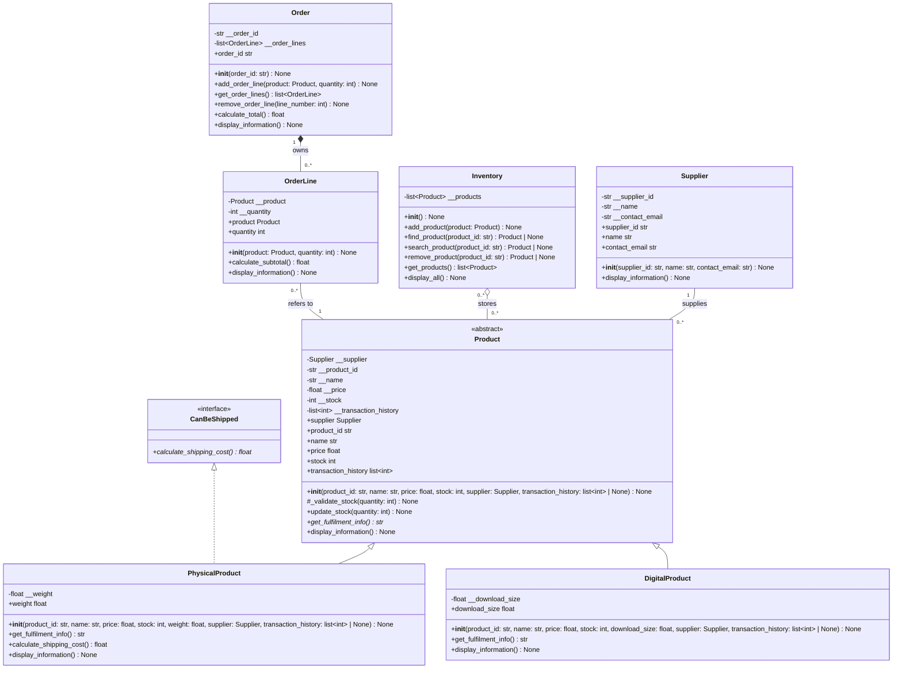

# Week 10 complete class diagram

Public properties are read-only. Constructors and method signatures match the source.
Product and CanBeShipped are abstract; abstract methods are marked with an asterisk.
Inventory permits products to be shared, so a Product may be in zero or more inventories.
Order creates each line internally and has no method for inserting an existing line.
Supplier and Product references do not imply ownership. Lists returned by accessors are copies.
The SVG is an overview; this diagram provides the complete typed interfaces.
