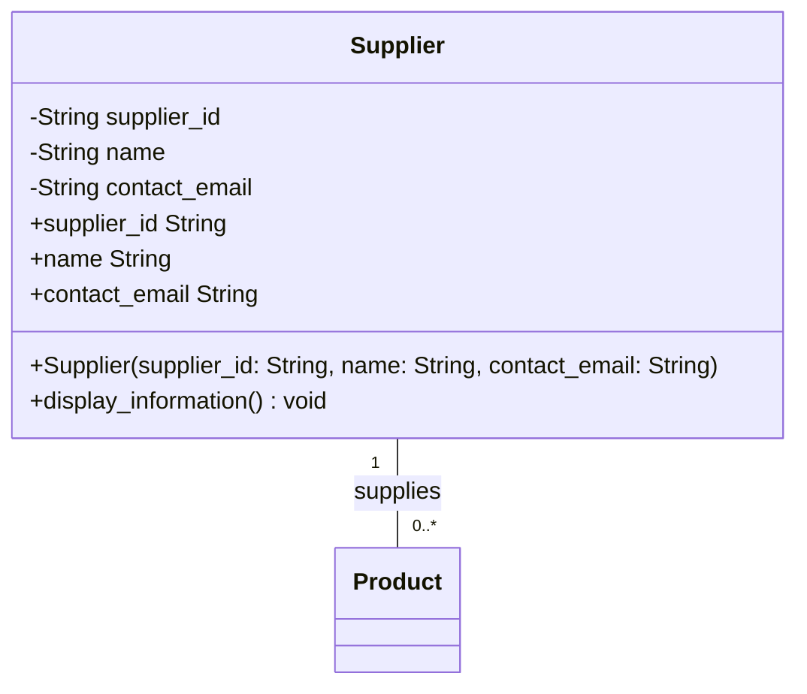

# Week 10 design and predictions

## Planned relationships

- Supplier is created separately and passed to Product. Each Product has one
  Supplier; one Supplier may supply several Products. This is association.
- Inventory keeps Product references. Removing a reference does not destroy the
  product. The existing design permits sharing between inventories, so both ends
  of the aggregation may have zero or more objects.
- Order creates its own OrderLine objects. Each line belongs to exactly one Order
  and cannot be transferred through the public API. This is composition.
- OrderLine refers to one Product without owning it. This is association.

## Supplier interface planned before implementation

The public supplier fields in this diagram are read-only properties backed by
private attributes. The final diagram will include all application classes.

## Predictions recorded before running relationship checks

### Section 2 supplier variable

Deleting the local `supplier` variable should not stop the products from showing
the supplier information. Each product still holds a reference to the same
Supplier object. `del` removes the variable binding, not every reference to the
object.

### Section 3 inventory removal

The product should still work after removal from Inventory A, because the test
code still refers to it. Inventory only removes its own reference. The same
object can then be added to Inventory B.

### Section 4 shared product in two orders

Adding one existing Product once to each of two Orders should create two separate
OrderLine objects referring to one shared Product object. Other products and
lines added in the wider test are separate from these counts.

### Section 7 fulfilment output

The physical product should return `This product requires physical shipping.`
The digital product should return `This product is delivered digitally by download.`
The same loop can call the method on both products because each subclass supplies
its own implementation.

## Results checked so far

Section 2 matched the prediction. After `del supplier`, both products displayed
the supplier details. Their supplier references were the same object, and its
`id()` matched the value saved before deleting the local variable. No correction
to the prediction was needed.

Section 3 matched the prediction. Removing P001 from Inventory A returned the
same object. Its stock was updated from 15 to 16 outside the inventory, and
Inventory B then found that exact same object using `is`. No correction was needed.

Sections 4 and 7 are still to be checked. The final Word notes will include all
four predictions, observed results and any differences after implementation.
The optional Section 10 reflection will not be included.

## Persistence and interface decisions

Supplier details are saved with each product. Loading reuses one Supplier object
for matching supplier IDs and rejects conflicting details for the same ID.
Legacy records without supplier details use the explicit UNASSIGNED placeholder
with name Supplier not recorded and contact Not provided. These are placeholders,
not claims about the real supplier. Existing inventory files remain unchanged
until the application is saved.

Inventory has typed add_product(product: Product), find_product(product_id: str),
remove_product(product_id: str), get_products() and display_all() methods.
Both find and remove return Product or None. Returning the removed reference
allows a caller to add the same product to another inventory. search_product()
remains an alias so the earlier menu continues working.
