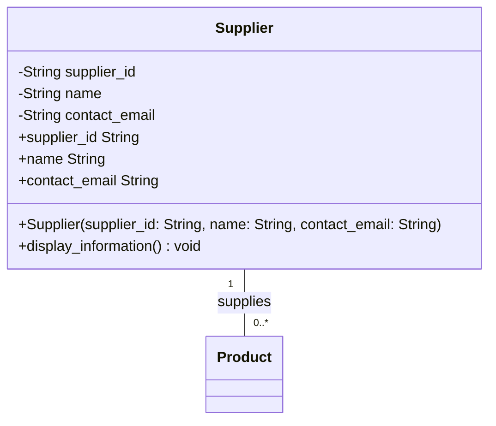

# Week 10 design and predictions

## Planned relationships

- Supplier is created separately and passed to Product. Each Product has one
  Supplier; one Supplier may supply several Products. This is association.
- Inventory keeps Product references. Removing a reference does not destroy the
  product. The existing design permits sharing between inventories, so both ends
  of the aggregation may have zero or more objects.
- Order creates its own OrderLine objects. Each line belongs to exactly one Order
  and cannot be transferred through the public API. This is composition.
- OrderLine refers to one Product without owning it. This is association.

## Supplier interface planned before implementation

The public supplier fields in this diagram are read-only properties backed by
private attributes. The final diagram will include all application classes.

## Predictions recorded before running relationship checks

### Section 2 supplier variable

Deleting the local `supplier` variable should not stop the products from showing
the supplier information. Each product still holds a reference to the same
Supplier object. `del` removes the variable binding, not every reference to the
object.

### Section 3 inventory removal

The product should still work after removal from Inventory A, because the test
code still refers to it. Inventory only removes its own reference. The same
object can then be added to Inventory B.

### Section 4 shared product in two orders

Adding one existing Product once to each of two Orders should create two separate
OrderLine objects referring to one shared Product object. Other products and
lines added in the wider test are separate from these counts.

### Section 7 fulfilment output

The physical product should return `This product requires physical shipping.`
The digital product should return `This product is delivered digitally by download.`
The same loop can call the method on both products because each subclass supplies
its own implementation.

## Results checked so far

Section 2 matched the prediction. After `del supplier`, both products displayed
the supplier details. Their supplier references were the same object, and its
`id()` matched the value saved before deleting the local variable. No correction
to the prediction was needed.

Section 3 matched the prediction. Removing P001 from Inventory A returned the
same object. Its stock was updated from 15 to 16 outside the inventory, and
Inventory B then found that exact same object using `is`. No correction was needed.

Section 4 matched the prediction. Adding the same physical product to two orders
created different lines (`is` was false), but both lines' product references
pointed to the same Product (`is` was true). No correction was needed. Adding a
second product at $12.50 with quantity 3 to an order containing two $100 products
gave a total of $237.50. Removing the first line left $37.50 and did not change
the Product or the other Order.

With no other strong references retained, a removed line and a deleted order's
line were also reclaimed in a weak-reference check. Python can keep an object
alive if external references exist; composition here describes intended ownership,
not a guarantee that `del` destroys all references everywhere.

Section 7 matched the prediction. The common Product loop returned exactly
`This product requires physical shipping.` for the physical product and
`This product is delivered digitally by download.` for the digital product.
The same show_product_details(product: Product) function worked for both without
subclass checks. No correction was needed. All four observations are now ready
to put into the final Word notes.
The optional Section 10 reflection will not be included.

## Persistence and interface decisions

Supplier details are saved with each product. Loading reuses one Supplier object
for matching supplier IDs and rejects conflicting details for the same ID.
Legacy records without supplier details use the explicit UNASSIGNED placeholder
with name Supplier not recorded and contact Not provided. These are placeholders,
not claims about the real supplier. Existing inventory files remain unchanged
until the application is saved.

Inventory has typed add_product(product: Product), find_product(product_id: str),
remove_product(product_id: str), get_products() and display_all() methods.
Both find and remove return Product or None. Returning the removed reference
allows a caller to add the same product to another inventory. search_product()
remains an alias so the earlier menu continues working.

## Order design

OrderLine has read-only product: Product and quantity: Integer properties and
calculate_subtotal(): Real. Order owns a private collection of OrderLine objects,
creates them in add_order_line(product: Product, quantity: Integer): void, and
removes them by one-based line number. calculate_total(): Real asks each line for
its subtotal. get_order_lines() returns a list copy for reading; no method accepts
an existing OrderLine for insertion or transfer. Public properties cannot be
reassigned, so each line keeps its product and quantity.

Orders are held in memory for the current run, use unique IDs within that run,
and do not reserve or deduct stock. Saving inventory still saves only products
and supplier details. The menu states these limits. Order persistence and checkout
are outside the required relationship exercise.

## Type hints and LSP checks

All 56 functions and methods across the ten application modules now have return
annotations and annotations for parameters other than self. Product's stored
attributes, Supplier references, subclass measurements and object collections
also have explicit types. An AST audit checked annotation presence; this was not
a full static type-checker run. Type hints do not enforce runtime values.

Product promises that update_stock accepts non-negative integer totals, replaces
the current stock, records the difference and returns None. Both subclasses use
the inherited implementation. Direct checks with 0, 5 and 12 passed for both.
Negative, fractional and Boolean quantities were rejected without changing state.
Both objects also worked in the same Inventory and through the same typed helper.

### Required LSP diagnosis

The proposed DigitalProduct method that always raises NotImplementedError violates
LSP because code using Product expects update_stock to work for a valid quantity.
For this system, I would remove that override and keep the shared Product stock
behaviour, treating digital stock as available copies or licences. If digital
products truly must not have stock, the design should separate stock management
from Product rather than adding special cases to Inventory.

### Polymorphism explanation

show_product_details accepts Product and calls the same methods on either object.
Python selects each object's display and fulfilment implementation, which is
polymorphism. LSP supports this because both subclasses honour the Product
interface and its expected behaviour, so the caller does not need special cases.
