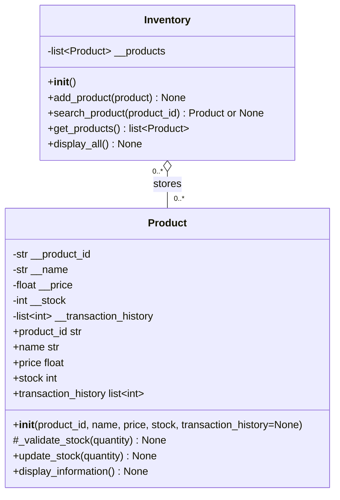

# OOP inventory class diagram

The application has two classes. Menu and JSON storage are functions, not classes.
`+` means public, `-` means private, and `#` means an internal helper by convention.
The hollow diamond shows aggregation: Inventory holds Product objects that can
also exist independently. An inventory may contain zero or more products.

The public Product attributes shown above are **read-only properties** backed by
private attributes. `transaction_history` and `Inventory.get_products()` return
list copies. `_validate_stock()` is a static helper. Stock updates must go through
`update_stock()` so validation and history stay together.

## Responsibilities

| Component | Responsibility |
| --- | --- |
| `Product` | Hold one product's information, validate and update its stock, display its information. |
| `Inventory` | Store, add, search and display Product objects. |
| `inventory_manager.py` | Show the menu, collect input and call public methods. |
| `inventory_storage.py` | Convert between JSON records and objects; read and write the file. |

JSON dictionaries are used only for storage. The running inventory holds Product
objects. Neither class asks for input or accesses files.
