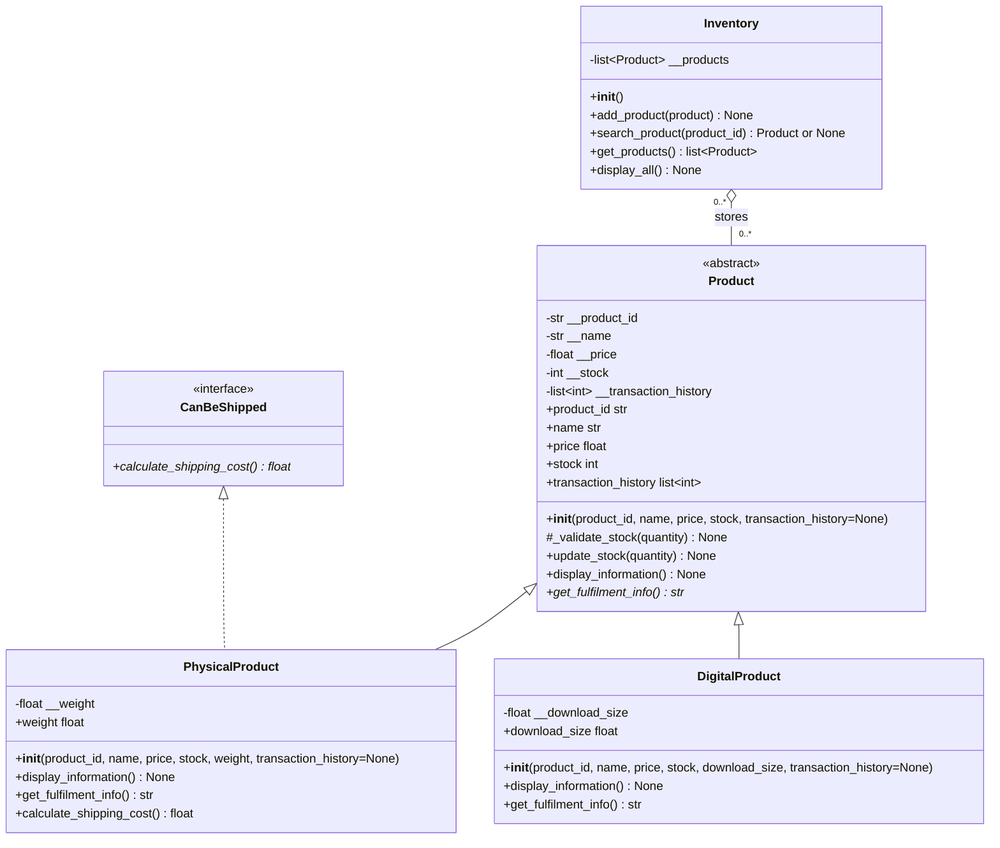

# Week 9 / Lab 7 class diagram

- Product is abstract. `get_fulfilment_info()` is abstract, while the shared
  constructor, stock updates and display method have implementations.
- Solid lines with hollow triangles are inheritance. Dashed lines with hollow
  triangles are interface realisation. `CanBeShipped` is implemented as an ABC
  with only an abstract method and no product state or shipping implementation.
- Python spells interface implementation as `PhysicalProduct(Product,
  CanBeShipped)`. This uses one product implementation base and one interface
  contract; it does not inherit implementations from two product classes.
- Product properties and the two measurement properties are read-only. History
  and collection accessors return copies of their lists. `_validate_stock` is static.
- The hollow diamond represents aggregation: Inventory stores Product objects.
  Objects can exist independently and can be shared between inventories.
- Menu and storage remain function-based modules. They are not extra classes.
- The separate SVG is a readable overview; this diagram lists the complete
  application class interfaces. Inherited members are not repeated in subclasses.
